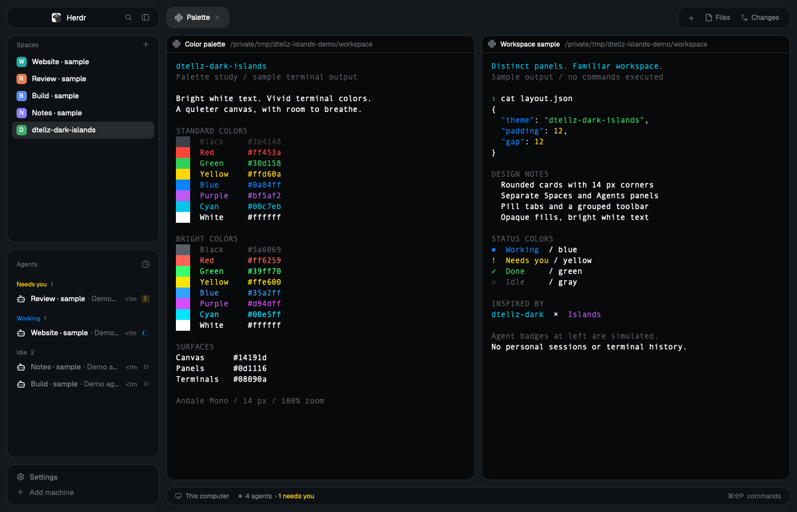

# dtellz-dark-islands

A dark, rounded-card layout for [Herdr](https://herdr.dev/) that combines the bright text and vivid terminal colors of [dtellz-dark](https://github.com/dtellz/dtellz-dark) with the separated panel design of [Islands by Cody Packer](https://github.com/CodeyPacker/herdr-mods/tree/main/islands). A muted blue canvas surrounds darker panels and nearly black terminals.



The screenshot is captured from an isolated Herdr session with labeled sample terminal output and simulated agent statuses. It contains no personal workspace history.

The layout has 12 px margins and gaps, 14 px rounded cards, pill-shaped tabs, and a grouped toolbar. Spaces, Agents, the brand row, the footer, and the status bar each have their own card. The optional Files and Changes panels use Herdr's standard interface.

## What's included

```text
themes/dtellz-dark-islands.json          Color palette
layouts/dtellz-dark-islands.json         Islands-style window layout
layouts/dtellz-dark-islands.svg          Layout-picker illustration
mods/dtellz-dark-islands-{spaces,agents,pane,tabs,chrome,status}/
                                       Six adapted Herdr panels and their assets
preview.png                            Gallery screenshot
RECIPE.md                              Brief for rebuilding the layout and theme
LICENSE                                Apache-2.0 license
NOTICE                                 Attribution and modification summary
licenses/                              Islands and icon license notices
```

The six mods are personal copies of Herdr 0.1.13's Spaces, Agents, pane header, tabs, workspace chrome, and status bar. They keep the standard controls and add the rounded-card styling. The package depends on Herdr's installed standard mods and assets, including Files, Changes, menus, the picker, program icons, and the Herdr logo. It includes no fonts, key map, saved sessions, personal paths, or app state.

The theme and layout deliberately share the name `dtellz-dark-islands`. Herdr treats a theme with the same name as a layout as belonging to that layout. For a palette intended for other layouts, use the original [dtellz-dark](https://github.com/dtellz/dtellz-dark).

## Install

Use Herdr 0.1.13 or a compatible later version with its standard mods installed. This package targets the 0.1.13 API. Validated with Herdr 0.1.13 on macOS; Windows and Linux have not been tested.

From the repository root, run the following in a POSIX shell with Python 3 available. It installs only `themes/`, `layouts/`, and `mods/` into `HERDR_APP_HOME`, or `~/.config/herdr-app` when that variable is unset. It checks all destination paths first, accepts identical installed files, and refuses differing files or symlinks before copying anything.

```sh
export HERDR_APP_HOME="${HERDR_APP_HOME:-$HOME/.config/herdr-app}"
python3 - <<'PY'
import os
from pathlib import Path

source = Path.cwd().resolve()
home = Path(os.path.abspath(os.path.expanduser(os.environ["HERDR_APP_HOME"])))
files = []
directories = {home}

for parent in (home, *home.parents):
    if parent.is_symlink():
        raise SystemExit(f"Refusing symlink in destination path: {parent}")
    if parent.exists() and not parent.is_dir():
        raise SystemExit(f"Expected a destination directory: {parent}")

for folder in ("themes", "layouts", "mods"):
    root = source / folder
    if root.is_symlink() or not root.is_dir():
        raise SystemExit(f"Expected a regular package directory: {root}")
    directories.add(home / folder)
    for item in sorted(root.rglob("*")):
        if item.is_symlink():
            raise SystemExit(f"Refusing package symlink: {item}")
        destination = home / item.relative_to(source)
        if item.is_dir():
            directories.add(destination)
        elif item.is_file():
            files.append((destination, item.read_bytes()))
        else:
            raise SystemExit(f"Expected a regular package file: {item}")

for directory in sorted(directories, key=lambda p: len(p.parts)):
    if directory.is_symlink() or (directory.exists() and not directory.is_dir()):
        raise SystemExit(f"Refusing existing destination: {directory}")

for destination, contents in files:
    if destination.is_symlink():
        raise SystemExit(f"Refusing existing symlink: {destination}")
    if destination.exists() and (
        not destination.is_file() or destination.read_bytes() != contents
    ):
        raise SystemExit(f"Refusing to overwrite different file: {destination}")

for directory in sorted(directories, key=lambda p: len(p.parts)):
    directory.mkdir(parents=True, exist_ok=True)
for destination, contents in files:
    if not destination.exists():
        with destination.open("xb") as output:
            output.write(contents)
print(f"Installed dtellz-dark-islands into {home}")
PY
```

If installation reports a collision, review the existing files before continuing. Local edits, including different attribution comments, count as differences; this is not an overwrite or upgrade command.

After a successful copy, run Herdr with the same home, check all six mods, and activate the layout:

```sh
(
  for dtellz_mod in spaces agents pane tabs chrome status; do
    herdr-app check "$HERDR_APP_HOME/mods/dtellz-dark-islands-$dtellz_mod" || exit 1
  done
  herdr-app do layout.switch --name dtellz-dark-islands
)
herdr-app status
```

Herdr must be running for `layout.switch` and `status`. Choose Dark appearance for this dark palette. The layout is also available in Settings. To return to the standard window:

```sh
herdr-app do layout.switch --name main
```

On Windows, copy the same runtime folders into the corresponding folders in your Herdr home, checking for collisions first, then run the six checks and the layout-switch command. Do not copy repository documentation or personal Herdr state into the runtime folders.

## Colors and opacity

| Role | Color |
| --- | --- |
| Canvas | `#14191d` |
| Sidebar, toolbar, and status cards | `#0d1116` |
| Terminal and surface backgrounds | `#08090a` |
| Main text | `#ffffff` |
| Secondary text | `#84898e` |
| Accent | `#627b8e` |
| Working / blocked / done | `#0a84ff` / `#ffd60a` / `#30d158` |

The palette retains dtellz-dark's ANSI colors and text colors, with darker blue canvas and chrome values selected for this layout. Programs may supply their own RGB colors, other 256-color entries, or faint text; the theme does not replace those choices.

Cards are opaque. The layout's `terminal_opacity: 0` only suppresses Herdr's rectangular terminal background so the opaque, rounded pane frame can show through. It does not make the window see-through. This package implements no frosted-glass blur or desktop translucency, and it does not include Islands' optional 85% panel opacity behavior.

## Fonts

The layout inherits your terminal font, font size, interface font, and zoom. The reference look uses Andale Mono at 14 px and 100% zoom. No font files are bundled; Herdr's JetBrains Mono is a suitable installed alternative.

The original [dtellz-dark README](https://github.com/dtellz/dtellz-dark#font-and-macos-font-smoothing) documents an optional macOS font-smoothing preference and how to restore it. That preference is separate from this theme and is never applied during installation.

## What the mods access

The mods retain Herdr's standard workspace behavior. Spaces runs Git commands to read repository, branch, and worktree information, watches local repository folders, and queries `hc` for machines. Machine reconnection uses core commands when requested through the interface. Commands for remote workspaces run on their corresponding machines. Agent ordering, group choices, and panel choices use Herdr's normal shared state or per-mod storage.

The shipped Files and Changes panels read the current workspace and use their standard file and Git operations. Buttons can open terminals, agents, menus, settings, and worktree tools through Herdr commands. The custom styling adds no `fetch` calls or separate network service; existing remote-machine features remain available through Herdr.

## Maintenance

The bundled mods are clones, so Herdr updates do not replace or merge into them. Their styling changes are small, but a future Herdr API change may require comparing each clone with its shipped counterpart. Run `herdr-app check` for every changed mod and inspect it in the live app; the initial check does not exercise every row, popup, or asynchronous state.

Existing sidebar sizes, theme-picker selections, enabled panels, and per-space choices can affect the result. This package does not overwrite `settings.json`, `keys.json`, `shared.json`, `view.json`, or `layouts/.state/`.

## Publish to the Herdr gallery

A local Git commit prepares the package but does not publish it. Push this folder to a public GitHub repository and add the repository topic **`herdr-layout`**. Keep `RECIPE.md`, `preview.png`, `layouts/`, `themes/`, and the six required `mods/` folders in the repository.

Herdr's [gallery instructions](https://herdr.dev/gallery/#share) say eligible repositories are discovered within an hour; community pictures are screened before appearing. The screenshot should show the actual running layout with demonstration content, rather than personal terminal history.

## Credits and license

- [dtellz-dark by Diego Tellez](https://github.com/dtellz/dtellz-dark) provides the palette and the packaging approach.
- [Islands by Cody Packer](https://github.com/CodeyPacker/herdr-mods/tree/main/islands) provides the separated rounded-panel design, spacing, and tab/toolbar treatment.
- [Herdr](https://github.com/herdrdev/herdr-app) provides the original layout and panel implementations, version 0.1.13.
- Bundled SVG icons include Lucide and Feather artwork with their original license notices.

The package uses Apache-2.0 with the applicable upstream MIT and ISC notices retained. See [LICENSE](LICENSE), [NOTICE](NOTICE), [Islands' MIT license](licenses/Islands-MIT.txt), and [Lucide/Feather notices](licenses/Lucide-Feather.txt). The original palette used Rex as a visual reference; no Rex code, icons, fonts, or other application assets are included.
