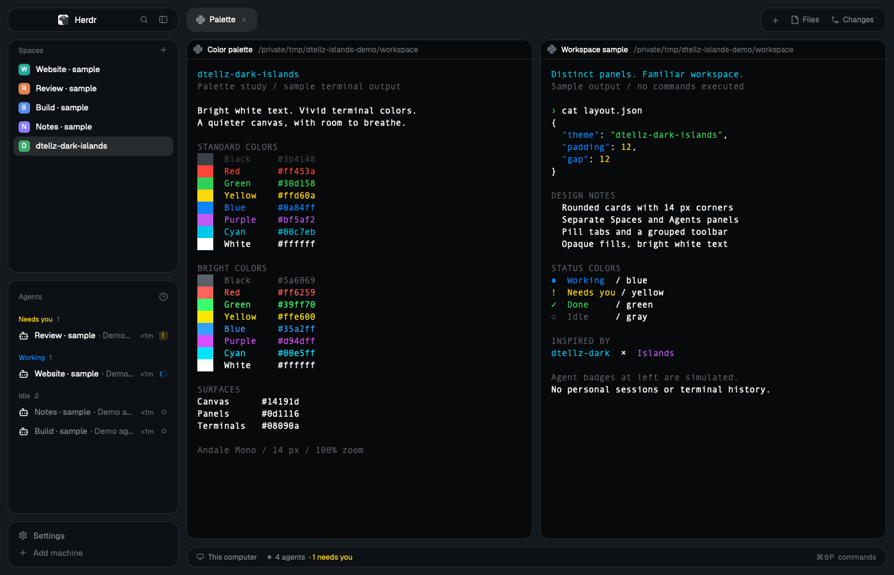

# dtellz-dark-islands

A dark Herdr workspace with separate rounded cards for Spaces, Agents, the terminal panes, and the window controls. A blue-charcoal canvas shows through the 12 px gaps around the darker panels. It combines the palette of [dtellz-dark](https://github.com/dtellz/dtellz-dark) with the panel arrangement of [Islands by Cody Packer](https://github.com/CodeyPacker/herdr-mods/tree/main/islands), using personal copies of Herdr's standard panels. The panel backgrounds are opaque.



## What you see

At zoom 1, the whole layout is inset 12 px from the window edges. The canvas is `#14191d`, the sidebar and toolbar cards are `#0d1116`, and terminal cards are `#08090a`. Cards have 14 px corners and a 1 px `#262b2f` border. There are 12 px gaps between the main regions. The focused terminal keeps the same border as its neighbors.

The left column is initially 268 px wide, with a 44 px minimum and 480 px maximum. From top to bottom it contains:

- A 38 px brand card with Herdr's logo and name, search, and the sidebar toggle. Its empty area drags the window.
- A Spaces card with colored letter tiles, space names, and relevant repository, branch, and ahead/behind information. The selected space has a `#272b2e` fill. Worktree spaces nest under their main checkout. Machines become collapsible groups when remote machines are present.
- An Agents card with groups, program icons, task labels, elapsed times, status marks, and pin controls on hover. The two list cards divide their available height equally and each has a 90 px minimum.
- A 72 px footer card containing Settings and Add machine, with 8 px vertical padding.

The right column has three regions, separated by 12 px:

- A 38 px tab strip with no full-width fill. Each tab is a 14 px rounded pill with 14 px horizontal padding, a 1 px border, and 12.8 px text. The active tab uses `#272b2e` with white text; inactive tabs use `#08090a` with muted text. The `+`, Files, Changes, and applicable window buttons share a separate rounded toolbar card on the right. An open Files or Changes button uses the selected fill and white text.
- The active tab's terminal panes. Each pane is a rounded card, including a tab with only one pane. Split panes have 12 px gaps. Every pane has an always-visible 30 px header showing program, folder, and status. Split-right, split-down, zoom, and close controls appear on header hover. Terminal content has 16 px vertical and 14 px horizontal padding. An optional Files or Changes card opens beside the panes at 368 px wide, with a 280 px minimum and 900 px maximum; these shipped panels retain their own 10 px corners.
- A 32 px status card with machine name, branch when available, agent count, and a yellow count of agents needing attention. The ordinary icons, text, and agent-count dot are muted. A command-palette shortcut hint sits on the right.

Foreground text is `#ffffff`, secondary text is `#84898e`, and dim text is `#656c72`. The slate accent is `#627b8e`. Agent colors are blue `#0a84ff` for working, yellow `#ffd60a` for blocked, green `#30d158` for done, and `#656c72` for idle. Fonts and terminal text size come from the person's Herdr settings; this layout bundles and forces no font. The sidebar text is about 13 px and pane-header text is 12 px, before app zoom.

Popups, dialogs, and notifications use Herdr's own frames. The layout does not give those overlays its 14 px card corners.

## How it behaves

The window shows the same spaces, tabs, panes, and agents as other Herdr layouts. Switching layouts preserves that work. The package installs no key bindings, so keyboard commands follow the person's existing `keys.json`.

Click a space to select it, right-click for its standard menu, or drag it to reorder it within its machine. The row being dragged fades temporarily to 50%, and an accent line shows the destination. Worktree grouping follows the repository information. The Spaces `+` creates a space; machine groups also offer a `+` for a space on that machine. Collapsed machine groups retain their heading. A rebuilt-machine Connect control performs Herdr's reconnection flow; other unavailable machines display their state.

The sidebar toggle reduces the column to a rail: 76 px on macOS, 44 px elsewhere. Below 160 px, Spaces and Agents show compact numbered rows and status marks. The Agents rail has a `»` control to restore the previous width. On macOS the brand rail reserves room for native window buttons. The footer keeps its icons while its text labels disappear.

Agent priority is blocked, done, working, then idle. The Agents menu switches between priority and grouping by space, while pinned agents stay at the top. Group headings and parent-agent controls fold their children. Hovering an agent reveals its pin/unpin control; clicking its row focuses its pane. Clicking a sub-agent peeks at its terminal. Agent-next and agent-previous commands follow the order this list displays.

- **Working:** a blue spinner turns natively; tabs and pane headers also show the spinner.
- **Blocked:** a yellow “Needs you” badge, or a compact `!` where the group heading already supplies that label. Tabs show a yellow dot; pane headers show the badge. The status card adds the yellow attention count.
- **Done:** a green dot. Once an agent is viewed Herdr changes it to idle; the Agents list holds a just-viewed done agent in its group until focus leaves it.
- **Idle:** an outlined dim ring in the Agents list and muted task text when not focused. Tab and pane headers have no idle badge.

Click a tab to select it, double-click to rename it, right-click for the standard tab menu, or drag from one tab to another to reorder them. Scrolling over the tab strip selects the previous or next tab. The active tab has a close button. `+` opens Herdr's normal terminal/agent launcher. Files and Changes switch or close the side panel; its choice is remembered per space. Their visibility also honors Herdr's enabled workspace panels.

Clicking a pane header focuses that pane. Its hover controls split, zoom/unzoom, or close that specific pane. Pane dragging remains Herdr's native grip behavior. The brand and tab-strip backgrounds drag the window, while their controls stop that drag gesture. Native macOS traffic lights use window coordinates `[24, 24]`; Windows and Linux receive the tab-strip window controls appropriate to the platform.

Search opens the shipped picker, Settings opens Herdr settings, Add machine opens the shipped machine dialog, and the status-bar hint opens the command palette. The hint is derived from the current palette key binding rather than a fixed shortcut. The theme picker may replace the layout's color scheme; the mods read theme colors at render time.

## Built from

The package contains a layout and a separate theme named `dtellz-dark-islands`. The layout and six mods are derived from Herdr 0.1.13 and retain `cloned_from` metadata. The arrangement follows Islands; the palette follows dtellz-dark with only two changes: `canvas` becomes `#14191d` and `chrome` becomes `#0d1116`. All other terminal, ANSI, and named UI colors are preserved from dtellz-dark.

Use this complete theme data:

```json
{
  "background": "#08090a",
  "foreground": "#ffffff",
  "selection": "#293746",
  "cursor": "#0a84ff",
  "ansi": ["#3b4148", "#ff453a", "#30d158", "#ffd60a", "#0a84ff", "#bf5af2", "#00c7eb", "#ffffff", "#5a6069", "#ff6259", "#39ff70", "#ffe600", "#35a2ff", "#d94dff", "#00e5ff", "#ffffff"],
  "colors": {
    "canvas": "#14191d", "chrome": "#0d1116", "surface": "#08090a",
    "popover": "#1c2023", "raised": "#272b2e", "hover": "#1e2225",
    "selected": "#272b2e", "border": "#262b2f", "input": "#323638",
    "foreground": "#ffffff", "muted": "#84898e", "dim": "#656c72",
    "accent": "#627b8e", "accent_foreground": "#08090a",
    "solid": "#32383d", "solid_foreground": "#c8cdd2", "ring": "#7e8286",
    "working": "#0a84ff", "blocked": "#ffd60a", "done": "#30d158",
    "idle": "#656c72", "unknown": "#656c72"
  }
}
```

Build the layout as this node tree. Preserve these IDs because panel controls address them:

```text
root: row, padding 12, gap 12, background canvas
├─ sidebar: column, width 268, min 44, max 480, gap 12, resizable false
│  ├─ brand: block, height 38, dtellz-dark-islands-chrome
│  ├─ sidebar-lists: column, gap 12
│  │  ├─ spaces: block, weight 1, min 90, dtellz-dark-islands-spaces
│  │  └─ agents: block, weight 1, min 90, dtellz-dark-islands-agents
│  └─ sidebar-footer: block, height 72, dtellz-dark-islands-chrome
└─ work: column, gap 12, resizable false
   ├─ tabs: block, height 38, dtellz-dark-islands-tabs
   ├─ work-body: row, padding 0, gap 12
   │  ├─ main: block, tab active, pane frames
   │  └─ panel: column, initially hidden, width 368, min 280, max 900
   │     └─ panel-body: stack, active files
   │        ├─ files: block, shipped files mod
   │        └─ changes: block, shipped changes mod
   └─ status: block, height 32, dtellz-dark-islands-status
```

The root specifies `titlebar: "none"`, `traffic_lights: [24, 24]`, `theme: "dtellz-dark-islands"`, `terminal_padding: [16, 14]`, `terminal_opacity: 0`, and `preview: "layouts/dtellz-dark-islands.svg"`. Brand and tabs have `window_drag: true`. Brand, Spaces, Agents, footer, and status have radius 14 and a 1 px `border`; their mods paint opaque `chrome` fills rounded to 13 px inside those borders. They remove the original bars' dividing lines. The footer gets 8 px vertical padding. Compact list rows get a 5 px horizontal inset and 6 px corners.

The native pane frame on `main` has `gap: 12`, `radius: 14`, `background: "background"`, `lone: true`, and both normal and focused borders set to 1 px `border`. Its header uses `dtellz-dark-islands-pane`, 30 px high at the top with `reveal: "always"`. The header paints an opaque theme background with 13 px top corners.

The six personal mods preserve the corresponding shipped behavior:

| Mod | Role and inputs | Main Herdr interfaces |
| --- | --- | --- |
| `dtellz-dark-islands-chrome` | Brand by default; footer when `props.footer` is true | `theme`, `window`, `layout`, `props`, `shared`, `setShared`, `updates`; `layout.resize`, `app.settings`, `mod.open` |
| `dtellz-dark-islands-spaces` | Live spaces, machine groups, repository metadata, worktree ordering | `spaces`, `machines`, `panes`, `theme`, `window`, `layout`, `exec`, `hc`, `watchFolder`, shared state; `space.new`, `space.select`, `space.move`, `openOverlay` |
| `dtellz-dark-islands-agents` | Live agent list; `props.sortMenu` selects its own sort popup | `agents`, `terminals`, `panes`, `focused`, `spaces`, `theme`, `props`, shared state, `setAgentOrder`; `pane.focus`, `terminal.peek`, `terminal.pin`, `layout.resize`, overlay open/close |
| `dtellz-dark-islands-tabs` | Active space's tabs and remembered per-space side panel | `spaces`, `panes`, `theme`, `window`, `layout`, `settings`, `shared`; tab select/move/rename/close/next/previous, layout select/show/hide, window controls, `openOverlay` |
| `dtellz-dark-islands-pane` | One header per pane, with `props.pane` and `props.terminal` | `panes`, `props`, `theme`, `home`; `pane.focus`, `pane.split`, `pane.zoom`, `pane.close` |
| `dtellz-dark-islands-status` | Machine, branch, agent count, bound palette shortcut | `spaces`, `agents`, `theme`, `window`, `keys`; `app.palette` |

Use GPUI builders from `gpui-kit` and `gpui-base`. Motion uses the native spinner's `.spin(900)`. The package has no HTML, CSS, web view, font bundle, wallpaper, custom key file, or opacity settings watcher.

The Spaces mod runs `git --no-optional-locks -c core.fsmonitor=false status --porcelain=v2 --branch`, `git rev-parse --show-toplevel`, and `git rev-parse --path-format=absolute --git-common-dir` in the live project folders, on their configured machine when remote. It watches local Git metadata with `watchFolder`. It calls `hc machine ls --json`, and the rebuilt-machine Connect action calls `hc machine rm` and `hc machine add` before refreshing the machine list. These are the stock panel behaviors, including reads outside the mod folder. The mods contain no independent web fetches. Remote core operations use the person's configured Herdr connections.

Per-mod localStorage retains panel choices, machine folding/reconnection state, and agent timestamps. Shared state supplies workspace panel availability, sidebar width, agent sorting, and space colors. Ship code and assets only, not the author's saved state.

Reuse Herdr's shipped `files`, `changes`, `menu`, `new-menu`, `picker`, and `machine-add` mods and the dialogs they open. Asset dependencies include the shipped `workspace-chrome` icons, `mods/pane/close.svg`, `mods/files/file.svg`, `mods/changes/changes.svg`, `frame/welcome/herdr.png`, and program icons supplied by Herdr. Package the personal chrome's settings/plus/search/sidebar SVGs, the pane header's five control SVGs, and the tabs' four Windows control SVGs. `layouts/dtellz-dark-islands.svg` is the 160 × 100 settings thumbnail. `preview.png` is a gallery screenshot using demonstration content, not a source of runtime data. Preserve the project's license and attribution files.

## Watch out

- Herdr does not clip a mod's paint to its layout node radius. Round and clip each full-size panel root with `.rounded(13).overflow_hidden()` or square fills will cover the card corners. Pane headers use `.rounded_t(13)`.
- `terminal_opacity: 0` suppresses the terminal's square background so the opaque rounded pane frame supplies the fill. It does not make the window see-through. Keep `pane.background: "background"` opaque. Do not add the old 85% alpha helpers or a runtime layout rewrite.
- Apps inside a terminal can paint their own backgrounds and colors. Their content is not controlled by this layout's mods.
- This is a dark palette. The normal theme picker can override it, and inherited font/zoom settings can make another person's window look different from the gallery image.
- The clones are based on Herdr 0.1.13 and do not update with Herdr. After an app upgrade, compare them with the new shipped originals and reapply the visual changes. Test deferred rows, hover controls, and popups in the app; `herdr-app check` only proves initial rendering.
- The Files and Changes cards and all popup/dialog frames remain shipped components. Their rounding is not changed to 14 px. No native frosted-glass or desktop translucency is implemented.
- Mac traffic lights are in window coordinates. Keep the 12 px root inset and `[24, 24]` position together, preserve non-fullscreen padding, and keep the 76 px macOS rail wide enough for the native buttons.
- Retain the `sidebar`, `main`, `panel`, `panel-body`, `files`, and `changes` IDs. Retain the Agents popup's reference to `dtellz-dark-islands-agents`. Name collisions on installation require renaming all matching layout, theme, mod, preview, and self-reference paths together.
- Do not copy `.state`, `shared.json`, `data`, personal keys/settings, generated `.d.ts` files, or generated `jsconfig.json` into the package. Existing installation state can override a person's theme choice or panel sizes; exercise the installed layout when checking it.

## Done when

1. The layout, thumbnail, theme, and all six personal mod folders are installed under the person's Herdr home without replacing shipped files. The theme uses the exact palette above, and the package includes source credits and licenses for the reused work.
2. Every installed mod passes `herdr-app check <mod-folder>`. Then `herdr-app do layout.switch '{"name":"dtellz-dark-islands"}'` succeeds and `herdr-app status` reports no layout or mod errors.
3. A live `herdr-app shot` shows a blue-charcoal canvas with 12 px margins/gaps, four separate left-hand cards, rounded terminal panes, pill tabs, a separate toolbar card, and the bottom status card. The pane's bottom corners are clean and all card backgrounds are opaque.
4. Tabs select and rename, the launcher opens, and Files/Changes can open, switch, and close beside the terminal. Returning to a space restores its side-panel choice.
5. The sidebar collapses and expands, compact rows stay inside their cards, and macOS window buttons do not overlap controls. Pane-header hover controls act on their own pane; splitting and zooming preserve the rounded frames.
6. With real reporting agents present, working/blocked/done/idle displays match the descriptions above; sorting, pinning, folding, focusing, and sub-agent peeking work. A demonstration screenshot alone is not proof of those live statuses.
7. Settings shows the layout thumbnail. The gallery preview depicts the actual installed layout with clean demonstration content and no private paths, conversations, or project names.
